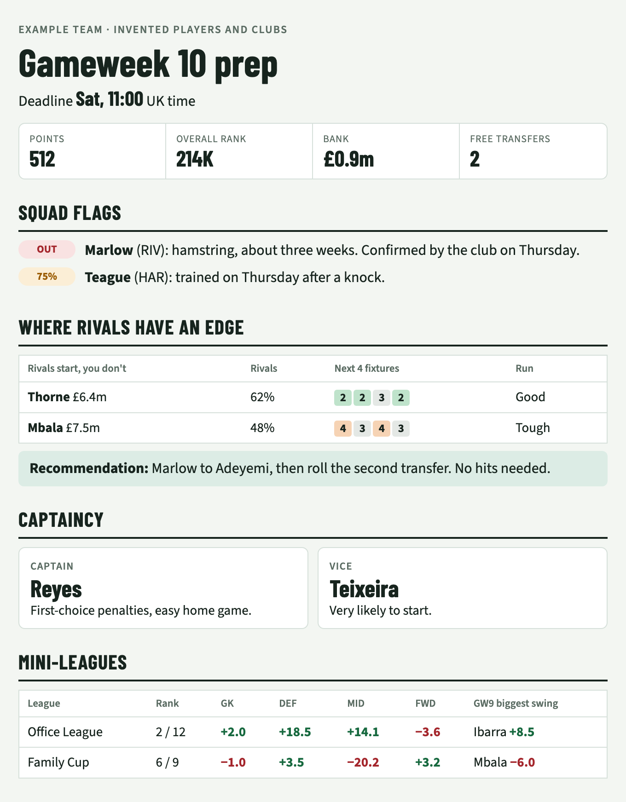

# FPL Gameweek Brief

A Claude skill that preps your Fantasy Premier League team before every deadline. Give it your team ID and it tells you who's injured, who to bring in, who to captain and who to bench.

<p align="center"></p>

## Try it in 2 minutes

1. **Download the skill.** Get `fpl-gameweek-brief.zip` from the [latest release](https://github.com/sumanreddy89/fpl-gameweek-brief/releases/latest). Use this file rather than **Code → Download ZIP**: Claude needs the folder inside the ZIP to be named exactly `fpl-gameweek-brief`, and GitHub's own download adds `-main` to it.
2. **Add it to Claude.** First turn on **Code execution and file creation** in **Settings → Capabilities**. Then go to **Customize → Skills**, click **+**, choose **Create skill → Upload a skill**, and pick the ZIP. In Claude Code, clone it into your skills folder instead:
   ```bash
   git clone https://github.com/sumanreddy89/fpl-gameweek-brief ~/.claude/skills/fpl-gameweek-brief
   ```
3. **Find your team ID.** On the FPL website, open **Points** and copy the number from the address bar: `fantasy.premierleague.com/entry/`**`1234567`**`/event/8`
4. **Ask Claude:**
   > Prep my FPL team for the next gameweek. My team ID is 1234567.

Made transfers since the last deadline? FPL keeps them private until the deadline passes, so paste your current 15 players or a screenshot of your Pick Team screen along with the question.

## What you get

Every brief includes:

- **Squad flags:** injuries, suspensions, doubts and players losing minutes, each with a dated source
- **Transfer options:** one to three moves that fit your bank and free transfers, plus whether to roll or take a hit
- **Captain and vice-captain picks,** with one alternative
- **A starting XI and bench order** that works with the auto-sub rules
- **Chip timing and a price-change watch,** using FPL's own price predictor
- **Mini-league insight:** who your rivals start and you don't, your differentials, and which players swung each gameweek in your small private leagues
- **An after-deadline note,** when run on a schedule: who you want to score and to blank in each league

The skill only recommends. It never signs in to FPL or changes your team.

See a [sample brief](examples/sample-brief.md) (invented players) for the format.

## What's inside

```
fpl-gameweek-brief/
├── SKILL.md                 # instructions the agent follows
├── docs/
│   └── example-brief.png    # the example above
├── scripts/                 # Python 3, standard library only
│   ├── fpl_snapshot.py      # pulls and trims the public FPL data
│   ├── fpl_daily.py         # says if a brief or note is due and flags price moves
│   └── fpl_leagues.py       # compares your picks with your mini-leagues
├── tests/                   # offline tests on invented data
└── examples/
    └── sample-brief.md      # what a finished brief looks like
```

`fpl_snapshot.py` exists because FPL's main data file is several megabytes, which is too big for most agents to read whole. The script cuts it down to about 40 KB: your squad with recent minutes, set-piece roles and estimated selling prices, fixtures, chips, an estimate of your free transfers, blank and double gameweeks, and the best transfer candidates you can afford in each position, ranked over the coming fixtures.

```bash
python3 scripts/fpl_snapshot.py --team-id 1234567
```

Useful options:

| Option | What it does |
|---|---|
| `--squad "Raya,Saka,..."` | Uses these 15 players instead of the public squad, which is needed after mid-week transfers |
| `--bank 1.5` | Sets the bank in £m. Without it, `--squad` estimates the bank from your changes |
| `--all-prices` | Lists candidates even if one transfer can't afford them, for planning two-transfer moves |
| `--horizon 4` | How many gameweeks of fixtures to show |
| `--candidates 6` | How many transfer candidates to list per position |
| `--min-minutes 450` | Leaves out candidates with fewer season minutes than this, so one big game doesn't top the list |
| `--data-dir DIR` | Reads saved JSON files instead of the live API, for offline testing |

## Mini-leagues and daily checks

```bash
python3 scripts/fpl_leagues.py --team-id 1234567   # how your picks did against each small private league
python3 scripts/fpl_daily.py --team-id 1234567     # is a brief due today, and any price moves to act on tonight
```

`fpl_leagues.py` shows where your rivals have an edge, the players who swung each gameweek, and your net gain or loss by position, plus rival captains and chips. It makes about one request per rival per gameweek, so it only covers private leagues of up to 30 managers unless you name one with `--league`. A full season can take a couple of minutes.

### Reading the mini-league numbers

For each gameweek, a player's number is: (your multiplier − the league's average multiplier) × his points. A multiplier is 0 if he's not in your starting XI, 1 if he starts, 2 as captain and 3 with Triple Captain.

- You captain a player who scores 10, and the league's average multiplier for him is 1.2: (2 − 1.2) × 10 = **+8**.
- You don't own a player who scores 6, and the league's average multiplier for him is 0.7: (0 − 0.7) × 6 = **−4.2**.

The script reports three views for each league:

- **Each gameweek:** the player who gave you the biggest upside and the biggest downside against the league that week.
- **Each position:** your net gain or loss for goalkeepers, defenders, midfielders and forwards, over the season and the last five gameweeks.
- **Each player, across the season:** the total, split into what came from owning him and what came from captaining him.

The script leads with `decisions`, which shows the gaps as facts rather than a score: who your rivals start and you don't, who you bench and they start, your differentials, rival captains, and each transfer target's coming fixtures with a good, mixed or tough run label. Rival lineups are from the last deadline. Past losses and costly benchings are included as context.

After a deadline, `--after-deadline` shows who you want to score and to blank in each league. Each player's `swing_per_point` is exact: −0.7 means every point he scores moves you 0.7 further behind the league's average.

Read season totals by position. Players in one position replace each other, so choosing Verbruggen over Raya shows up as a gain and a loss, but it's one decision. A negative number only means your rivals got more from that player than you did. All the numbers in a league add up to your gap to its average, before hits.

### Running it on a schedule

Use one recurring task that runs every evening and calls `fpl_daily.py`. It says whether a brief or after-deadline note is due and lists any price moves worth acting on. Avoid having each run schedule the next one, because unattended runs can stop for approval when they create a task.

For a cloud task, attach this repository so each run uses the latest scripts, and add `fantasy.premierleague.com` to your allowed domains. A skill uploaded to your Claude account may include only `SKILL.md`, so don't rely on it for the scripts.

## Other agents

The skill uses the open Agent Skills layout: a folder containing a `SKILL.md`. Agents that support the same format can load it from wherever they keep skills.

## Limits

- **Recent transfers aren't visible.** FPL only publishes a squad after each deadline, so transfers made since the last one won't appear. Tell the agent your current 15 players, or share a screenshot of your Pick Team screen.
- **Free transfers are an estimate,** based on the current rules (+1 each gameweek, a maximum of 5, and none used on Wildcard or Free Hit weeks). Check the number in the app.
- **Selling prices are an estimate,** worked out from your public transfer log. Check the app if a move is tight on budget.
- **Some sandboxes block the FPL site.** The skill falls back to a browser tool or to smaller endpoints when that happens. Price alerts and mini-league analysis need the scripts to reach the site.
- **Price predictions are a guide.** FPL's predictor doesn't guarantee a price change.

## Tests

```bash
python3 -m unittest discover -s tests
```

## Disclaimer

This is an unofficial, fan-made project. It is not affiliated with or endorsed by the Premier League or Fantasy Premier League. It uses undocumented public endpoints, which can change without notice. It reads data at run time for your own personal use, and this repository does not redistribute any FPL data. Check Fantasy Premier League's terms and conditions, linked from the FPL site, before using it for anything beyond managing your own team.

## License

MIT, see [LICENSE](LICENSE).
