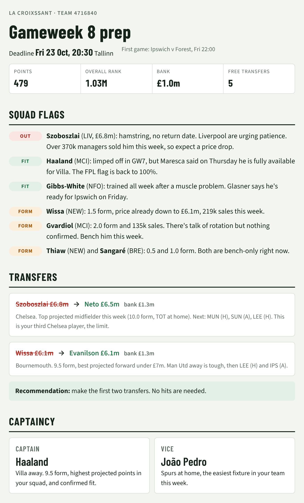

[README.md](https://github.com/user-attachments/files/33878530/README.md)
# FPL Gameweek Brief

A Claude skill that preps your Fantasy Premier League team before every deadline. Give it your team ID and it tells you who's injured, who to bring in, who to captain and who to bench.

<p align="center"></p>

## Try it in 2 minutes

1. **Download the skill.** Click **Code → Download ZIP** at the top of this page.
2. **Add it to Claude.** In Claude, go to **Settings → Capabilities** and upload the ZIP as a skill. In Claude Code, clone it into your skills folder instead:
   ```bash
   git clone https://github.com/sumanreddy89/fpl-gameweek-brief ~/.claude/skills/fpl-gameweek-brief
   ```
3. **Find your team ID.** On the FPL website, open **Points** and copy the number from the address bar: `fantasy.premierleague.com/entry/`**`1234567`**`/event/8`
4. **Ask Claude:**
   > Prep my FPL team for the next gameweek. My team ID is 1234567.

Made transfers since the last deadline? FPL keeps them private until the deadline passes, so paste your current 15 players or a screenshot of your Pick Team screen along with the question.

## What you get

Every brief includes:

- **Squad flags:** injuries, suspensions, doubts and players losing minutes, each with a dated source
- **Transfer options:** one to three moves that fit your bank and free transfers, plus whether to roll or take a hit
- **Captain and vice-captain picks,** with one alternative
- **A starting XI and bench order** that works with the auto-sub rules
- **Chip timing and a price-change watch**

The skill only recommends. It never signs in to FPL or changes your team.

## What's inside

```
fpl-gameweek-brief/
├── SKILL.md                 # instructions the agent follows
├── docs/
│   └── example-brief.png    # the example above
└── scripts/
    └── fpl_snapshot.py      # pulls and trims the public FPL data (Python 3, standard library only)
```

`fpl_snapshot.py` exists because FPL's main data file is several megabytes, which is too big for most agents to read whole. The script cuts it down to about 20 KB: your squad, fixtures, chips, an estimate of your free transfers, blank and double gameweeks, and the top-projected players in each position.

```bash
python3 scripts/fpl_snapshot.py --team-id 1234567
```

Useful options:

| Option | What it does |
|---|---|
| `--squad "Raya,Saka,..."` | Uses these 15 players instead of the public squad, which is needed after mid-week transfers |
| `--bank 1.5` | Sets the bank (in £m) to go with `--squad` |
| `--horizon 4` | How many gameweeks of fixtures to show |
| `--candidates 6` | How many transfer candidates to list per position |
| `--min-minutes 450` | Leaves out candidates with fewer season minutes than this, so one big game doesn't top the list |
| `--data-dir DIR` | Reads saved JSON files instead of the live API, for offline testing |

## Other agents

The skill uses the open Agent Skills layout: a folder containing a `SKILL.md`. Agents that support the same format can load it from wherever they keep skills.

## Limits

- **Recent transfers aren't visible.** FPL only publishes a squad after each deadline, so transfers made since the last one won't appear. Tell the agent your current 15 players, or share a screenshot of your Pick Team screen.
- **Free transfers are an estimate,** based on the current rules (+1 each gameweek, a maximum of 5, and none used on Wildcard or Free Hit weeks). Check the number in the app.
- **Some sandboxes block the FPL site.** The skill falls back to a browser tool or to smaller endpoints when that happens.

## Disclaimer

This is an unofficial, fan-made project. It is not affiliated with or endorsed by the Premier League or Fantasy Premier League. It uses undocumented public endpoints, which can change without notice. It reads data at run time for your own personal use, and this repository does not redistribute any FPL data. Check Fantasy Premier League's terms and conditions, linked from the FPL site, before using it for anything beyond managing your own team.

## License

MIT, see [LICENSE](LICENSE).
